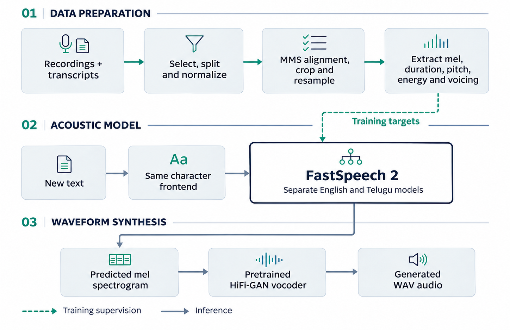

# FastSpeech 2 · English & Telugu

University assignment: separate English and Telugu FastSpeech 2 acoustic models, evaluated through saved metrics, generated samples and variance-adaptor plots.

**[Start here →](START_HERE.md)** · [Listen to results](RESULTS.md#assignment-samples) · [Technical report](Report/Technical_Report.pdf) · [Validation](VALIDATION.md)

> **Evaluation:** the code, report, metric CSVs, ten audio samples and variance plots are included here. Acoustic checkpoints are available through the Drive links below. Access permissions and a fresh Colab run remain unverified; the report marks listening assessment as pending.

## Evaluation guide

| Task | Open in Colab | Training data needed? |
|---|---|---|
| **Enter text and hear speech** | [04 · Custom TTS](notebooks/04_Custom_Text_to_Speech.ipynb) | No |
| Generate all 10 assignment samples | [03 · Evaluate](notebooks/03_Evaluate_and_Generate_Assignment_Outputs.ipynb) | No |
| Prepare data for new training | [00 · Setup & data](notebooks/00_Setup_and_Data.ipynb) | Downloads it |
| Train / resume English | [01 · English](notebooks/01_Train_English.ipynb) | Features + targets |
| Train / resume Telugu | [02 · Telugu](notebooks/02_Train_Telugu.ipynb) | Features + targets |

## Quick start

1. Download the [English backup](https://drive.google.com/file/d/1PkGkmCfh1C-CWESDjNyl2X6fdpA-Glz-/view?usp=sharing) and [Telugu backup](https://drive.google.com/file/d/19iQEstcLrXOf2nZ_M55uACsjxP0Oa9xk/view?usp=sharing).
2. Extract them into your own Drive. See the [backup tree](START_HERE.md#backup-folder-layout).
3. Open notebook **04** in Colab; choose GPU for speed or use CPU.
4. Fill [Notebook settings](START_HERE.md#notebook-settings): code URL **or** code-folder path, plus your backup-folder path. The repository is [pragati-jain340/fastspeech2-english-telugu](https://github.com/pragati-jain340/fastspeech2-english-telugu).
5. Run the cells in order → enter text → play/download the WAV.

**Inference downloads HiFi-GAN once; it does not download the training datasets.**

## Architecture: data to speech



**Audio → mel** happens during preprocessing using STFT and mel filters. **Mel → audio** happens after acoustic prediction using HiFi-GAN. Both model variants use characters and MMS durations; the vocoder is separately pretrained and is not jointly trained with our acoustic models.

## Repository tree

```text
project/
├── English/                   # English entry points
│   ├── preprocess.py
│   ├── train.py
│   ├── inference.py
│   ├── config.yaml
│   └── checkpoints/           # Manifest; weights downloaded separately
├── Telugu/                    # Same structure, Telugu configuration
├── shared/                    # Model, frontend, features, training, vocoder
├── notebooks/                 # Five Colab workflows: 00–04
├── Results/
│   ├── English/
│   └── Telugu/                # WAVs, predictions, plots, metric CSVs
├── Report/
│   ├── Technical_Report.md    # Editable source
│   └── Technical_Report.pdf   # Technical report
├── scripts/                   # Import, evaluation, report, packaging
├── tests/                     # Focused correctness checks
├── evidence/                  # Split records, run settings and verification results
├── test_sentences.json        # Original + separate spoken-form text
├── START_HERE.md              # Execution instructions
├── RESULTS.md                 # Metrics, curves, sample links
└── requirements.txt
```

## Saved training at a glance

| Language | Latest epoch / updates | Best frame-prosody epoch |
|---|---:|---:|
| English | 50 / 40,200 | 48 |
| Telugu | 60 / 25,500 | 56 |

Use **`best_mel.pt` for inference** and **`last.pt` for resume**. [Full metrics →](RESULTS.md)

## Scope of evaluation

| Available to the evaluator | Location |
|---|---|
| Technical approach, analysis and limitations | [Technical report](Report/Technical_Report.pdf) |
| Metrics, loss curves and all ten samples | [Results](RESULTS.md) |
| English and Telugu trained weights | Drive links in Quick start above |
| Preprocessing, training and inference instructions | [Start here](START_HERE.md) |
| Recorded checks and reproduction limits | [Validation](VALIDATION.md) |
| Source-row splits and saved run settings | [Submitted evidence](evidence/) |

Pretrained inference needs no raw training dataset. New training downloads the specified public datasets. Exact historical resume needs original feature archives and alignment files that are not fully distributed; this limitation does not prevent evaluating the supplied models.

<details>
<summary><strong>Reference implementation and adaptation</strong></summary>

Reference: [ming024/FastSpeech2](https://github.com/ming024/FastSpeech2). This submission implements a compact adaptation with the components and differences listed below.

| Component | This implementation |
|---|---|
| Acoustic backbone | Width 128; 2 encoder + 2 decoder blocks; 2 attention heads |
| Text/alignment | English characters; uroman Telugu characters; MMS durations |
| Variance heads | Duration, scalar pitch, energy and voicing |
| Character baseline | Prosody predicted before duration expansion |
| Frame prosody | Prosody predicted after expansion |
| Differences from reference/paper | No speaker embedding, Post-Net or later-paper CWT pitch representation |
| Legacy weights | Original notebook FastSpeech2 class retained separately |

The submitted model, loss and training modules preserve the computation used by the trained checkpoints. Each language has its own vocabulary and normalization statistics. The implementation differs from the full reference model and is not claimed to reproduce every paper component.

Vocoder: [jik876/HiFi-GAN](https://github.com/jik876/hifi-gan), commit `4769534d45265d52a904b850da5a622601885777`; [universal weights](https://huggingface.co/AlexAlexBabarika/hifigan-universal-v1), `g_02500000`. It was not jointly trained with the acoustic models. The known mel-padding mismatch is documented in [RESULTS.md](RESULTS.md).

This project uses the universal romanizer software 'uroman' written by Ulf Hermjakob, USC Information Sciences Institute (2015–2020). Reference: Hermjakob, May and Knight (2018), *Out-of-the-box universal romanization tool uroman*.

[FastSpeech 2 paper](https://arxiv.org/abs/2006.04558) · Reference README checked 6 November 2026.

</details>
