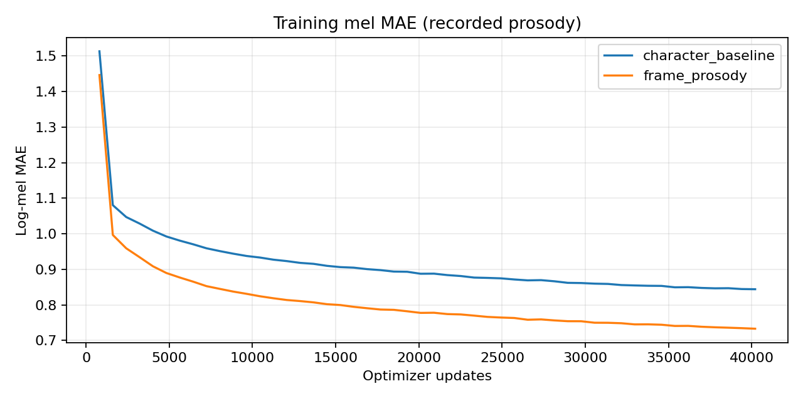
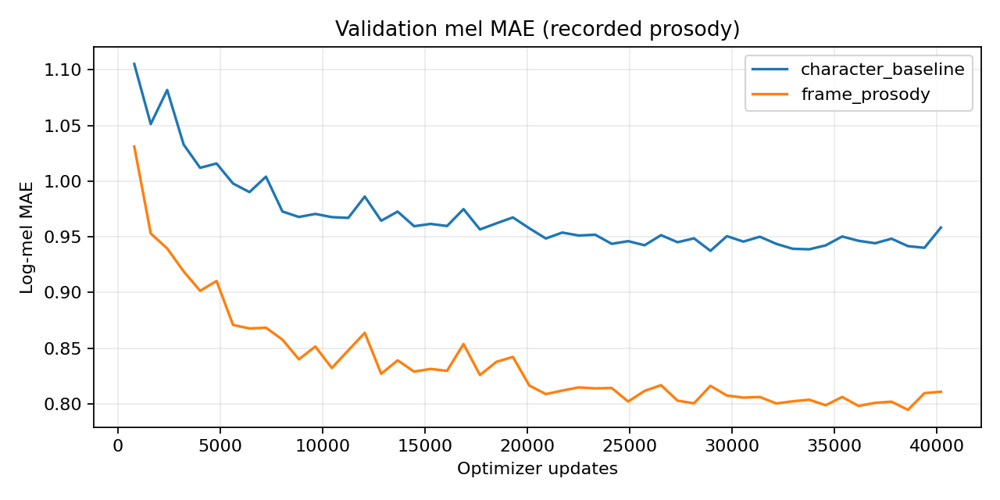
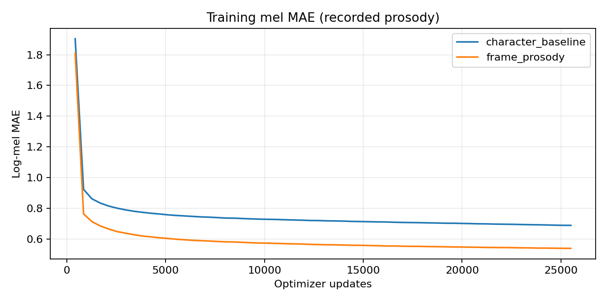
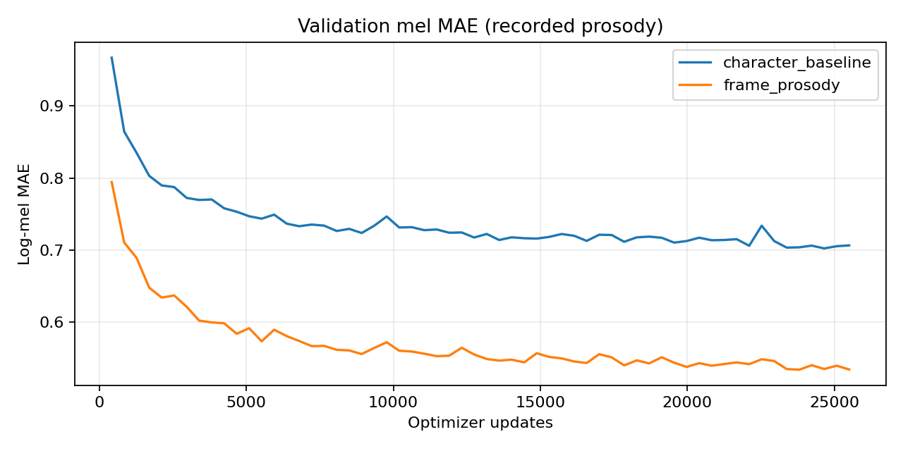

# Results

**10 / 10 assignment bundles verified** · **30 variance plots** · **8 compact checkpoints loaded strictly**

[Listen / inspect samples](#assignment-samples) · [Metrics](#checkpoint-metrics) · [Loss curves](#loss-curves) · [Validation details](VALIDATION.md)

> Mel validation uses **recorded durations and prosody**. Lower loss does not prove clearer text-only speech. Final listening review is pending.

## Dataset summary

| Language | Train clips | Validation clips | Train / validation mel-grid hours | Source-record overlap |
|---|---:|---:|---|---:|
| English | 3214 | 630 | 5.0056 / 1.0014 | 0 |
| Telugu | 1697 | 351 | 5.0039 / 1.0016 | 0 |

Hours count centered mel frames × 256/22050, not exact cropped waveform duration. Source-record overlap is zero; speaker independence is unverified. Missing original feature ZIPs prevent full historical per-clip verification.

<details>
<summary>Selection and training settings</summary>

- Sorted source shards; mono 2–20 s recordings; normalized-text/audio deduplication; seed 42.
- About 1 h validation, then 5 h training; aligned reserve clips top up crop durations.
- Telugu: gender code 0. English: diverse voices, no speaker embedding.
- Character inputs, uroman for Telugu, MMS character durations; digit-containing training transcripts excluded.
- Width 128; 2 encoder + 2 decoder blocks; 2 heads; dropout 0.1; batch 4; AdamW 0.0003; gradient clip 1.0.
- Original baselines and 16-clip memorization diagnostics are separate from these full-data compact runs.

</details>

## Checkpoint metrics

| Language | Variant | Best epoch | Updates | Best validation mel MAE | Last epoch | Final train / validation MAE |
|---|---|---:|---:|---:|---:|---|
| English | character_baseline | 36 | 28944 | 0.937435 | 50 | 0.844173 / 0.958347 |
| English | frame_prosody | 48 | 38592 | 0.794563 | 50 | 0.733233 / 0.810859 |
| Telugu | character_baseline | 58 | 24650 | 0.702442 | 60 | 0.689541 / 0.706587 |
| Telugu | frame_prosody | 56 | 23800 | 0.534438 | 60 | 0.539863 / 0.534669 |

| Use | Checkpoint | Latest saved run |
|---|---|---|
| Best-validation inference | `best_mel.pt` | Selected epoch shown above |
| Continue training | `last.pt` | English 50 / 40,200 updates; Telugu 60 / 25,500 |

Best epochs differ: use the final matched-update rows too. Prosody grids differ, so total losses are not directly interchangeable. Vocabulary, statistics, optimizer and RNG state are preserved.

## Loss curves

<details open>
<summary><strong>English: training and validation</strong></summary>




</details>

<details>
<summary><strong>Telugu: training and validation</strong></summary>




</details>

Training error falls; validation minima precede the final epochs. Curves use observed CSV rows only. This supports best-checkpoint selection, not a claim about audible quality.

## Assignment samples

Text-only frame-prosody synthesis: **English epoch 48**, **Telugu epoch 56**.

| ID | Audio | Duration plot | Pitch plot | Energy plot |
|---|---|---|---|---|
| E1 | [WAV](Results/English/test_generated_audios/E1.wav) | [duration](Results/English/variance_adaptor_plots/duration/E1.png) | [F0](Results/English/variance_adaptor_plots/pitch/E1.png) | [energy](Results/English/variance_adaptor_plots/energy/E1.png) |
| E2a | [WAV](Results/English/test_generated_audios/E2a.wav) | [duration](Results/English/variance_adaptor_plots/duration/E2a.png) | [F0](Results/English/variance_adaptor_plots/pitch/E2a.png) | [energy](Results/English/variance_adaptor_plots/energy/E2a.png) |
| E2b | [WAV](Results/English/test_generated_audios/E2b.wav) | [duration](Results/English/variance_adaptor_plots/duration/E2b.png) | [F0](Results/English/variance_adaptor_plots/pitch/E2b.png) | [energy](Results/English/variance_adaptor_plots/energy/E2b.png) |
| E3 | [WAV](Results/English/test_generated_audios/E3.wav) | [duration](Results/English/variance_adaptor_plots/duration/E3.png) | [F0](Results/English/variance_adaptor_plots/pitch/E3.png) | [energy](Results/English/variance_adaptor_plots/energy/E3.png) |
| E4 | [WAV](Results/English/test_generated_audios/E4.wav) | [duration](Results/English/variance_adaptor_plots/duration/E4.png) | [F0](Results/English/variance_adaptor_plots/pitch/E4.png) | [energy](Results/English/variance_adaptor_plots/energy/E4.png) |
| T1 | [WAV](Results/Telugu/test_generated_audios/T1.wav) | [duration](Results/Telugu/variance_adaptor_plots/duration/T1.png) | [F0](Results/Telugu/variance_adaptor_plots/pitch/T1.png) | [energy](Results/Telugu/variance_adaptor_plots/energy/T1.png) |
| T2a | [WAV](Results/Telugu/test_generated_audios/T2a.wav) | [duration](Results/Telugu/variance_adaptor_plots/duration/T2a.png) | [F0](Results/Telugu/variance_adaptor_plots/pitch/T2a.png) | [energy](Results/Telugu/variance_adaptor_plots/energy/T2a.png) |
| T2b | [WAV](Results/Telugu/test_generated_audios/T2b.wav) | [duration](Results/Telugu/variance_adaptor_plots/duration/T2b.png) | [F0](Results/Telugu/variance_adaptor_plots/pitch/T2b.png) | [energy](Results/Telugu/variance_adaptor_plots/energy/T2b.png) |
| T3 | [WAV](Results/Telugu/test_generated_audios/T3.wav) | [duration](Results/Telugu/variance_adaptor_plots/duration/T3.png) | [F0](Results/Telugu/variance_adaptor_plots/pitch/T3.png) | [energy](Results/Telugu/variance_adaptor_plots/energy/T3.png) |
| T4 | [WAV](Results/Telugu/test_generated_audios/T4.wav) | [duration](Results/Telugu/variance_adaptor_plots/duration/T4.png) | [F0](Results/Telugu/variance_adaptor_plots/pitch/T4.png) | [energy](Results/Telugu/variance_adaptor_plots/energy/T4.png) |

```text
Results/<Language>/
├── test_generated_audios/<ID>.wav
├── predictions/<ID>.npz             # Mel, labels/IDs, raw + converted duration,
│                                   # pitch, energy and voicing
├── predictions/<ID>.json            # Text, checkpoint/frontend/vocoder metadata
└── variance_adaptor_plots/
    ├── duration/<ID>.png
    ├── pitch/<ID>.png
    └── energy/<ID>.png
```

Verified WAVs: 22050 Hz, finite samples, length = mel frames × 256. Duration sums match mel length; this does **not** validate phonetic boundaries. [Generation inventory](Results/generation_inventory.csv)

## Reading the outputs

| Item | Interpretation |
|---|---|
| Duration bars | Character durations, not phoneme durations |
| F0 gaps | Unvoiced/invalid units; matching checkpoint statistics used |
| Negative energy | Retained and counted; not silently clipped |
| E4 / T4 | Explicit date/time expansion; original text stored separately |
| Unusual source spaces | Preserved in JSON; extracted PDF wording also retained |
| Shared vocoder | Universal HiFi-GAN `g_02500000`; independently pretrained |

<details>
<summary>Provenance and limitations</summary>

Vocoder: `AlexAlexBabarika/hifigan-universal-v1`, code commit `4769534d45265d52a904b850da5a622601885777`. Its original mel-padding convention differs from the acoustic centered STFT; comparisons preserve that known setup.

`test_sentences.json` retains supplied code strings and separate spoken forms; `evidence/assignment_pdf_text.txt` retains PDF extraction. Telugu PDF page 2 was visually checked. Spacing discrepancies (notably T1/T2b) are disclosed rather than silently rewriting saved outputs. Historical runtime paths in prediction JSONs are provenance, not defaults.

No completed final listening review, MOS, ASR error, phonetic-alignment accuracy or significance test is available. Pronunciation, stress, homograph handling, naturalness and code-mixed-word quality remain pending. Earlier baseline listening notes and 16-clip memorization do not establish final held-out quality.

Legacy `FastSpeech2` and later `PilotFS2` use separate classes. Both compact variants use characters/MMS durations; frame prosody changes the prediction grid.

</details>

[Technical report](Report/Technical_Report.md) · [Validation](VALIDATION.md)
