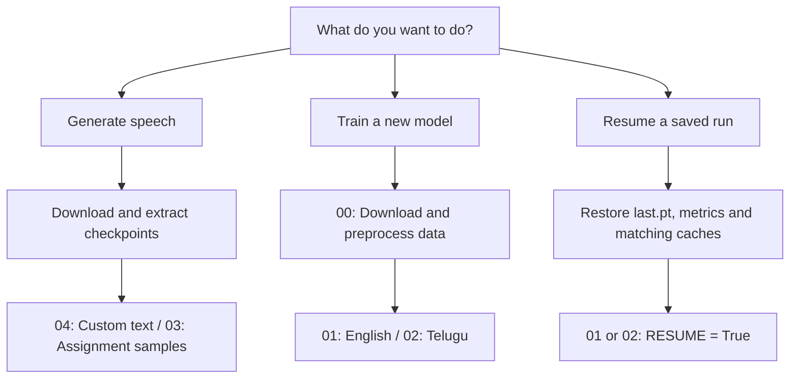

# Start here

**For speech generation, start with notebook 04.** You do not need to preprocess or train first.

[1 · Downloads](#1-download-checkpoints) → [2 · Settings](#notebook-settings) → [3 · Run](#3-run-in-colab) → [Outputs](#output-folders)

## Pick a workflow



## 1. Download checkpoints

| Language | Download |
|---|---|
| English | [english_model_complete_backup.zip](https://drive.google.com/file/d/1PkGkmCfh1C-CWESDjNyl2X6fdpA-Glz-/view?usp=sharing) |
| Telugu | [telugu_trained_epoch60](https://drive.google.com/file/d/19iQEstcLrXOf2nZ_M55uACsjxP0Oa9xk/view?usp=sharing) |

Download/copy both backups into **your own Drive**, then extract ZIPs. Sharing permissions have not yet been verified. Use the public GitHub repository URL above, or use an existing copy of this code folder.

### Backup folder layout

`BACKUP_DIR` points to the parent folder below. The importer searches nested folders too.

```text
MyDrive/FastSpeech2_backups/                 ← BACKUP_DIR
├── english_full_frame_prosody_v1/
│   ├── frame_prosody/
│   │   ├── best_mel.pt                     ← Best-validation inference
│   │   ├── last.pt                         ← Latest resume state
│   │   └── metrics.csv
│   ├── character_baseline/                 # Same three files
│   ├── train_sources.json
│   ├── validation_sources.json
│   ├── run_config.json
│   └── summary.json
└── telugu_full_frame_prosody_v1/             # Same contents
```

Vocabulary/statistics are embedded in checkpoints. Keep optimizer/RNG state in `last.pt`.

## Notebook settings

Fill the first code cell of your selected notebook:

| Setting | Enter this | Required? |
|---|---|---|
| `REPO_URL` | https://github.com/pragati-jain340/fastspeech2-english-telugu.git | Choose this **or** `EXISTING_REPO` |
| `EXISTING_REPO` | Existing code-folder path in Colab/Drive | Alternative to cloning |
| `BACKUP_DIR` | Path to extracted backups, as shown above | First pretrained run; blank for scratch training/already imported runs |
| `DATA_ROOT` | Your persistent storage folder | Keep the default if unsure |
| `MOUNT_DRIVE` | `True` | Recommended |

> **URLs vs paths:** `REPO_URL` is a URL. `BACKUP_DIR` and `EXISTING_REPO` are filesystem paths, not Drive sharing links. In Colab's Files panel, use **Copy path** after mounting Drive.

```python
REPO_URL = "https://github.com/pragati-jain340/fastspeech2-english-telugu.git"  # Replace with the real URL
EXISTING_REPO = ""  # Leave blank when cloning
DATA_ROOT = "/content/drive/MyDrive/FastSpeech2_Assignment"
MOUNT_DRIVE = True
BACKUP_DIR = "/content/drive/MyDrive/FastSpeech2_backups"  # Match your folder
```

If your code is already on Drive, leave `REPO_URL = ""` and set `EXISTING_REPO` to that code folder instead. `MyDrive` always refers to the person running Colab.

## 3. Run in Colab

1. Open [04 · Custom TTS](notebooks/04_Custom_Text_to_Speech.ipynb).
2. Choose **Runtime → Change runtime type → GPU** for speed. CPU inference also works.
3. Fill the settings above; select `LANGUAGE`, `VARIANT`, and `TEXT`.
4. Run cells from top to bottom; authorize your Drive mount.
5. Play/download the generated WAV in the final cell.

The notebook installs dependencies, imports checkpoints, and caches the original HiFi-GAN under `DATA_ROOT/cache/hifigan`. It preserves the existing torch/torchaudio versions.

**Numbers/dates:** set `SPOKEN_TEXT` to explicit words; keep `TEXT` unchanged. Unexpanded digits raise an error.

### Output folders

```text
DATA_ROOT/
├── runs/{english,telugu}/                  # Imported/trained checkpoints
├── cache/hifigan/                          # Reused vocoder code + weights
└── custom_audio/English/                   # Notebook 04 default; or Telugu
    ├── test_generated_audios/custom.wav
    ├── predictions/custom.{npz,json}
    ├── variance_adaptor_plots/
    │   ├── duration/
    │   ├── pitch/
    │   └── energy/
    └── generation_inventory.csv
```

Choose a new `OUTPUT` directory to retain earlier custom samples. Colab `/content` is temporary; Drive persists across resets.

## Generate all assignment outputs

Open [03 · Evaluate](notebooks/03_Evaluate_and_Generate_Assignment_Outputs.ipynb), fill the same settings, and run all cells. It generates **5 English + 5 Telugu samples**, plots and a ZIP download under `DATA_ROOT/Results/frame_prosody/`.

Original sentences and separate date/time expansions come from [test_sentences.json](test_sentences.json). Existing outputs are linked in [RESULTS.md](RESULTS.md#assignment-samples).

## Optional: train from scratch

| Step | Notebook | Setting/action |
|---|---|---|
| Prepare data | [00 · Setup & data](notebooks/00_Setup_and_Data.ipynb) | GPU; `LANGUAGES`; `RUN_PREPROCESSING = True` |
| Train English | [01 · English](notebooks/01_Train_English.ipynb) | `RUN_TRAINING = True`, `RESUME = False`, target 50 epochs |
| Train Telugu | [02 · Telugu](notebooks/02_Train_Telugu.ipynb) | `RUN_TRAINING = True`, `RESUME = False`, target 60 epochs |

Use a **fresh DATA_ROOT** for new training if imported weights already occupy the default runs. Preprocessing is expensive; it downloads datasets, selects/deduplicates clips, aligns original/reserve data, extracts features/targets and checks source separation. Compatible caches are reused by fingerprint.

Sources: [Svarah](https://huggingface.co/datasets/ai4bharat/Svarah) · [IndicTTS Telugu](https://huggingface.co/datasets/SPRINGLab/IndicTTS_Telugu). If requested, authenticate interactively with `huggingface_hub.login()`. No `.env` sharing is needed. Downloaded revisions are recorded; the historical revision was not supplied.

## Optional: resume training

**Restore:** `last.pt` + metric CSVs + exact original features, metadata, source order and frame targets.

Then open notebook 01 or 02 and set `RESUME = True`, `RUN_TRAINING = True`, and your **total target epochs**.

```text
Completed epoch 60 + TOTAL_TARGET_EPOCHS = 80 → train epochs 61–80
```

> **Historical resume is currently blocked by missing original feature ZIPs and some final alignment manifests.** Complete frame caches exist. Recover the missing assets before exact resume; regenerated features belong to a new run unless compatibility is established.

<details>
<summary><strong>Copy-paste setup and CLI commands</strong></summary>

Alternative to the notebook setup cells; edit the two placeholder paths first:

```python
REPO_URL = "https://github.com/pragati-jain340/fastspeech2-english-telugu.git"
BACKUP_DIR = "/content/drive/MyDrive/FastSpeech2_backups"
from google.colab import drive
drive.mount("/content/drive")
from pathlib import Path
import subprocess, sys, os
checkout = Path("/content/fs2-assignment")
if not checkout.exists():
    subprocess.run(["git", "clone", REPO_URL, str(checkout)], check=True)
project = checkout / "project" if (checkout / "project").is_dir() else checkout
os.chdir(project)
ROOT = Path("/content/drive/MyDrive/FastSpeech2_Assignment")
def run(*args):
    subprocess.run([sys.executable, *map(str, args)], check=True)
import torch, torchaudio
constraints = Path("/content/fs2-runtime-constraints.txt")
constraints.write_text(f"torch=={torch.__version__}\ntorchaudio=={torchaudio.__version__}\n")
run("-m", "pip", "install", "-q", "-r", "requirements.txt", "--constraint", constraints)
run("scripts/import_assets.py", "--source", BACKUP_DIR, "--destination", ROOT)
run("English/inference.py", "--root", ROOT, "--text", "The orchestra changed unexpectedly.")
from IPython.display import Audio, display
wav = ROOT / "Results/English/test_generated_audios/custom.wav"
display(Audio(filename=str(wav)))
from google.colab import files
files.download(str(wav))
```

After that cell, `run(...)` and `ROOT` are available:

```python
# Telugu custom text
run("Telugu/inference.py", "--root", ROOT, "--text", "తాడుపై అతని పట్టు చాలా బలంగా ఉంది.")
# Explicit number expansion
run("English/inference.py", "--root", ROOT, "--text", "The meeting starts at 10:45 AM.",
    "--spoken-text", "The meeting starts at ten forty five A M.")
# Assignment outputs; use --variant character_baseline for the comparison
run("scripts/evaluate.py", "--root", ROOT, "--output", ROOT / "Results/frame_prosody")
# New training: fresh run directories, newly preprocessed frame targets
run("English/preprocess.py", "--root", ROOT, "--stage", "all")
run("Telugu/preprocess.py", "--root", ROOT, "--stage", "all")
run("English/train.py", "--root", ROOT, "--run", ROOT / "runs/english_new", "--epochs", 50,
    "--targets", ROOT / "runs/english/frame_targets")
run("Telugu/train.py", "--root", ROOT, "--run", ROOT / "runs/telugu_new", "--epochs", 60,
    "--targets", ROOT / "runs/telugu/frame_targets")
# Historical cache adoption: only after missing original source assets are recovered
run("Telugu/preprocess.py", "--root", ROOT, "--stage", "import-cache",
    "--run", ROOT / "runs/telugu", "--targets", ROOT / "runs/telugu/frame_targets")
run("Telugu/train.py", "--root", ROOT, "--resume", "--epochs", 80)
```

Inference can use `--checkpoint /path/to/best_mel.pt` directly. `--mel-only` skips waveform synthesis. Resume restores model/optimizer/RNG/partial-epoch state; incompatible configuration or source order blocks it. Checkpoints persist each epoch and every 100 updates within an epoch.

</details>

## Troubleshooting

| Problem | What to do |
|---|---|
| Drive denies download | Ask the owner to enable evaluator access on the supplied links. |
| Missing checkpoint | Check extraction and `BACKUP_DIR`; rerun the importer. |
| Wrong model/vocabulary | Match the printed language/variant; never hide mismatches with `strict=False`. |
| No GPU | Use `DEVICE = "cpu"` for inference; use a GPU for full preprocessing/training. |
| Digits / unknown characters | Provide an explicit spoken form using supported training symbols. |
| Cache mismatch | Recover exact historical assets or use a new empty run/target directory. |
| Parquet schema changes | Loader discovers embedded bytes: English `audio_filepath`, Telugu `audio`; ambiguity raises an error. |
| Runtime reset | Mount the same Drive, rerun setup, then resume with the same root. |
| Dependency mismatch | Keep a matching torch/torchaudio pair; MMS preprocessing requires `MMS_FA`. |
| Vocoder mismatch | Check 22050 Hz, 80 bins, FFT/window 1024, hop 256, fmax 8000 and log-magnitude mel. The existing padding difference remains a limitation. |
